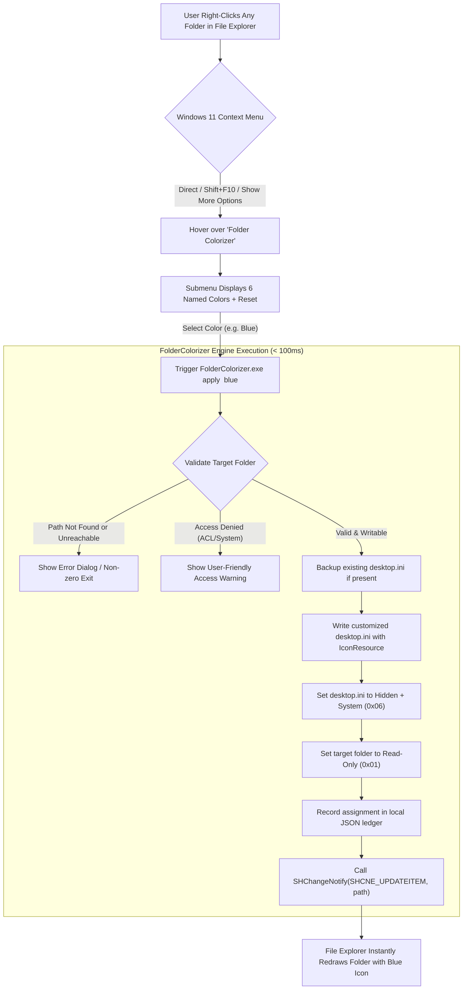
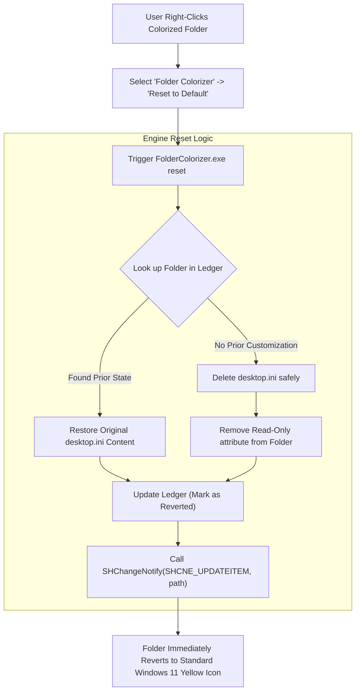

# 🔄 Pillar 3: Application & User Flow Specification — Folder Colorizer for Windows 11

## 1. Primary Workflow: Colorizing a Folder

---

## 2. Reset Workflow: Restoring Default Appearance

---

## 3. Mandatory States & Error Matrix

| State | Trigger Condition | System Behavior & User Communication | Recovery Action |
|---|---|---|---|
| **Loading / In-Flight** | Color verb clicked in context menu | Execution completes within 50ms; silent, instant visual switch in File Explorer. | None needed (instant). |
| **Success** | `desktop.ini` applied & `SHChangeNotify` emitted | Folder icon updates on screen; ledger timestamp updated. | User can immediately re-color or reset. |
| **Access Denied** | Target is inside `C:\Windows`, `Program Files`, or has read-only ACL | Native Windows modal: *"Cannot colorize this folder because Windows has restricted its access. Please choose a folder inside your user profile or external drive."* | Leaves folder untouched. Zero corrupt state. |
| **Missing Path** | Folder was renamed or deleted between menu open and click | Native Windows modal: *"Folder not found. It may have been moved or renamed."* | Removes stale entry from ledger. |
| **Network Share** | Target is on SMB / UNC path (`\\server\share`) | Evaluates if share supports hidden attributes; applies if supported or alerts if unsupported by server. | Gracefully handles non-NTFS volumes. |

---

## 4. Uninstallation Flow
1. User runs `uninstall.bat` (or Windows Settings &rarr; Installed Apps).
2. Prompt: *"Do you want to reset all colored folders back to default Windows icons before uninstalling?"*
   - **Option 1 (Recommended)**: Iterates over `assignments.json`, removes `desktop.ini`, removes `+r` attribute, and refreshes Explorer.
   - **Option 2 (Retain)**: Leaves icons in `%LocalAppData%\FolderColorizer\icons` so colored folders remain visually intact.
3. Removes `HKEY_CURRENT_USER\Software\Classes\Directory\shell\FolderColorizer` registry keys.
4. Cleans up application binaries.
