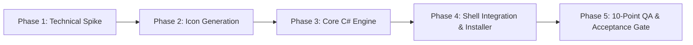

# 📅 Pillar 6: Implementation Plan & Milestones — Folder Colorizer for Windows 11

## 1. Phased Delivery Roadmap

---

## 2. Milestone Breakdown & Definition of Done

### Phase 1: Technical Spike (Mandatory PoC)
- **Goal**: Empirically prove folder icon persistence and Windows 11 shell refresh on this actual machine.
- **Tasks**:
  1. Create a test directory with space and Unicode characters.
  2. Write a minimal C# prototype invoking `SetFileAttributesW` and `SHChangeNotify`.
  3. Validate icon display in Windows 11 File Explorer.
  4. Test persistence across an Explorer process reload (`Stop-Process -Name explorer`).
- **Definition of Done (DoD)**: Target folder visibly switches icon, retains it after Explorer restart, and successfully reverts to default on reset.

### Phase 2: High-Definition Icon Asset Generation
- **Goal**: Produce production-grade multi-resolution `.ico` assets for the 6 palette colors.
- **Tasks**:
  1. Build icon generation utility (or script) creating 32-bit ARGB icons containing 16x16, 24x24, 32x32, 48x48, 64x64, 128x128, and 256x256 dimensions.
  2. Implement Fluent folder silhouette with two-tone shading and top tabs.
  3. Verify rendering in Extra Large, Medium, and Details views.
- **Definition of Done (DoD)**: All 6 `.ico` files saved to `src/Assets/` and validated.

### Phase 3: Core C# Engine Development
- **Goal**: Implement complete, robust, self-contained `FolderColorizer.exe`.
- **Tasks**:
  1. Implement `ShellHelper.cs` (P/Invoke `SHChangeNotify`, attribute manipulation).
  2. Implement `FolderManager.cs` (atomic `desktop.ini` creation, safety checks, attribute configuration, reset logic).
  3. Implement `LedgerManager.cs` (JSON assignment ledger for recovery/audit).
  4. Implement `RegistryManager.cs` (HKCU cascading context menu registrar).
  5. Implement `Program.cs` (CLI router: `apply`, `reset`, `register`, `unregister`, `gui`).
  6. Compile with Windows native `csc.exe` compiler into standalone `FolderColorizer.exe`.
- **Definition of Done (DoD)**: Executable compiles cleanly with 0 warnings and executes all CLI verbs without third-party dependencies.

### Phase 4: Per-User Setup & Clean Uninstaller
- **Goal**: Provide seamless, zero-friction install and uninstall for regular non-admin users.
- **Tasks**:
  1. Create `installer/install.bat` that deploys binaries and assets to `%LocalAppData%\FolderColorizer` and registers context menus.
  2. Create `installer/uninstall.bat` that offers automated reset of all colored folders before cleaning registry keys and directory assets.
- **Definition of Done (DoD)**: Clean install on user account; context menu appears immediately; clean uninstall leaves no orphan keys.

### Phase 5: Verification & Release Gate (PRD Acceptance Criteria)
- **Goal**: Validate all 10 acceptance criteria from the PRD on Windows 11.
- **Acceptance Checklist**:
  - [ ] **AC-01**: A user can color a normal local folder from File Explorer.
  - [ ] **AC-02**: All six colors display the correct named selection and icon.
  - [ ] **AC-03**: The assigned icon remains after restarting Explorer.
  - [ ] **AC-04**: Reset restores default appearance without modifying contents.
  - [ ] **AC-05**: Folders with spaces and Unicode names work without error.
  - [ ] **AC-06**: Access-denied errors are clear and do not corrupt folder state.
  - [ ] **AC-07**: Uninstallation leaves no broken icon references or dead menu entries.
  - [ ] **AC-08**: Shell integration works natively in Windows 11 context menu.
  - [ ] **AC-09**: Works 100% offline.
  - [ ] **AC-10**: No administrator prompts required for ordinary user-owned folders.
